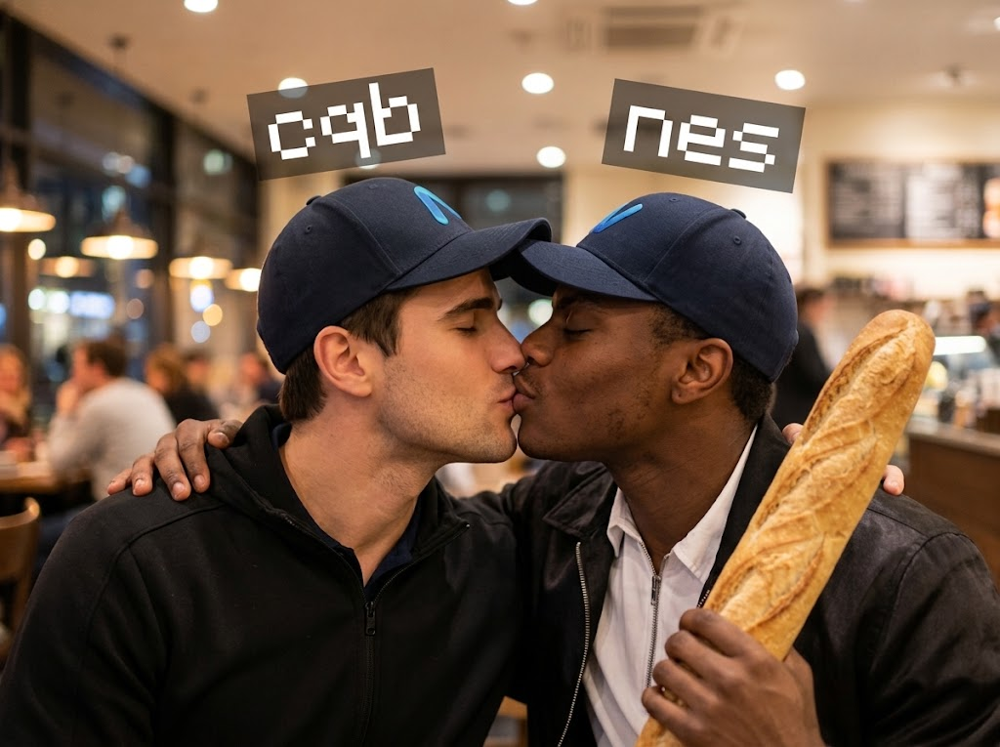

<div align="center">

# nighty.sex

**A tiny, full-screen image gallery with an endlessly scrolling strip.**

[View the site](https://nighty.sex/asset) · [Browse the images](https://github.com/aboveproof/nighty.sex/tree/main/asset)

<br>



<br><br>


</div>

## What is this?

nighty.sex is a single-page gallery built with plain HTML and CSS. Three images move across a black, full-screen canvas in a continuous loop. Hover over the gallery to pause it. When a visitor prefers reduced motion, the animation stops and the images can be scrolled horizontally instead.

The page also includes image-only Discord Components V2 link-preview data, plus Open Graph and Twitter image metadata as fallbacks. Vercel serves the same page at `/` and `/asset`.

## Run locally

There are no packages to install and no build step. Clone the repository and serve its root directory with any static file server. For example, with Python:

```bash
git clone https://github.com/aboveproof/nighty.sex.git
cd nighty.sex
python -m http.server 8000
```

Open [http://localhost:8000](http://localhost:8000). Opening `index.html` directly may also work, but a local server reproduces the root-relative asset paths used by the deployed site.

## Make it yours

| File | Purpose |
| --- | --- |
| `index.html` | Gallery markup, image alt text, Discord embed data, and social preview metadata |
| `style.css` | Full-screen layout, animation speed, hover pause, and reduced-motion behavior |
| `asset/` | The three gallery images |
| `vercel.json` | Static deployment settings and `/asset` route rewrites |

Replace the images in `asset/`, then update their paths in **both** the gallery markup and the preview metadata in `index.html`. Edit the image descriptions there as well. To change the scroll speed, adjust `30s` in `.marquee-track` in `style.css`.

## Deploy

Import the repository into Vercel. The included `vercel.json` selects a static deployment with the repository root as output and rewrites `/asset` to `index.html`. Set up your domain in Vercel if you want to use a different URL; update the absolute image and page URLs in `index.html` to match it.

## License

MIT
